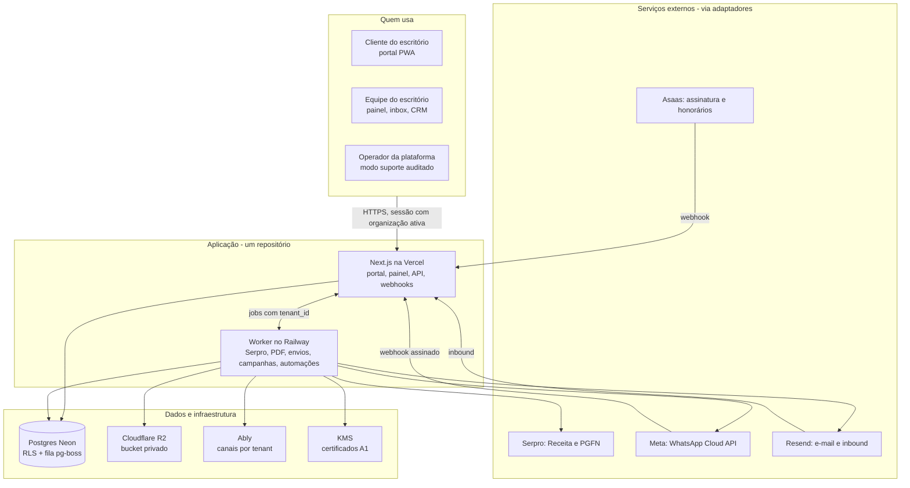

# Arquitetura e integrações

> Origem: Seções 7 e 10 do plano. As decisões estão em `adr/`.

## 7. Arquitetura proposta

A arquitetura é um monólito modular com dois processos do mesmo código. A **web** atende pessoas e recebe webhooks. O **worker** executa tudo o que é lento ou externo. O Postgres guarda dados e fila. Nenhuma requisição de usuário espera pela Serpro ou pela Meta sem prazo.

Os nomes de fornecedores são recomendações (ADRs 0003 e 0004) e podem ser trocados atrás dos adaptadores.

**Fluxo do recálculo:**

1. A web valida o tenant, a pessoa, a empresa e a guia.
2. A web cria o job com `tenant_id` e chave de idempotência.
3. O worker abre o certificado pelo KMS e chama a Serpro.
4. O worker grava a nova guia e o PDF no R2.
5. O worker publica o evento no canal do tenant no Ably e envia a guia pelo WhatsApp.

**Fluxo do inbox:**

1. A Meta chama o webhook.
2. A web confere a assinatura e mapeia o `phone_number_id` para o tenant.
3. A web grava o evento uma vez só e enfileira o job.
4. O worker cria a mensagem e a liga ao contato.
5. O worker avalia as automações e publica no canal do tenant.
6. O atendente vê a mensagem em até 3 s.

## 10. Integrações externas

Todas as integrações passam por um adaptador próprio, chamado pelos casos de uso e nunca direto da interface. Cada adaptador tem timeout, retentativa com backoff, idempotência e registro de custo por tenant.

| Integração | Uso | Autenticação | Pontos de atenção |
| --- | --- | --- | --- |
| Serpro Integra Contador | DAS do Simples e do MEI, recálculo, pagamentos, parcelamentos, DCTFWeb, situação fiscal, Caixa Postal | OAuth2 com mTLS usando o certificado do contratante; procuração eletrônica do contribuinte para o escritório | Cobrado por chamada (consulta R$ 0,24, emissão R$ 0,32); dois modos de conexão (abaixo); instabilidade em períodos de pico |
| Serpro Consulta Dívida Ativa | Radar de Débitos (PGFN) | Credencial Serpro | R$ 0,6591 por consulta na faixa 1; produto contratado à parte |
| WhatsApp Cloud API (Meta) | Inbox, templates, lembretes, campanhas, bot | Token do sistema por WABA; webhook com assinatura `X-Hub-Signature-256` | Cada escritório tem número e WABA próprios; templates aprovados pela Meta; janela de 24 h; tiers de envio; cobrança por mensagem entregue |
| E-mail transacional e de campanha (Resend ou Amazon SES) | Lembretes, cópias de guias, campanhas, inbox de e-mail | Chave de API; domínio de cada escritório verificado com DKIM, SPF e DMARC | E-mail de entrada para o inbox via webhook de inbound; reputação separada por domínio |
| Armazenamento (Cloudflare R2 ou S3) | PDFs de guias, documentos, anexos do WhatsApp | Chaves só no servidor | Bucket privado, URLs assinadas, criptografia em repouso, versionamento |
| Pix e código de barras | Exibir o Pix e a linha digitável da guia | Sem integração bancária | O Pix vem do PDF ou da resposta da Serpro; a plataforma só exibe e não movimenta dinheiro |
| Leitura de PDF | Envio em lote: CNPJ, valor, vencimento, código de barras | Biblioteca local (pdf.js ou pdfplumber) com regex por modelo de guia | OCR só como plano B para PDF escaneado; leitura incerta vai para revisão |
| Assinatura digital | Declaração de faturamento | e-CPF A1 do contador (PAdES) | O cliente assina depois pelo gov.br; validar aceitação pelos bancos |
| Cobrança da plataforma (Asaas ou similar) | Assinatura mensal dos escritórios | Chave de API e webhook | Depois do MVP; a Contact paga por boleto manual no início |

### Conexão fiscal (Serpro): dois modos por escritório

A tela **Conexões › Receita Federal** mostra o modo escolhido, a validade do certificado, um botão "Testar conexão" (faz uma consulta barata) e o consumo do mês.

1. **Modo plataforma (padrão, incluso no plano).**
   - O Pedro é o contratante do Integra Contador, como software house. O escritório entra como autor do pedido e procurador dos clientes.
   - O escritório autoriza a plataforma assinando o termo de autorização (serviço Autentica Procurador) com o e-CNPJ instalado no computador dele. O certificado nunca é enviado. No MVP, a assinatura é feita no Assinador do Serpro, que é gratuito, e só o arquivo assinado sobe para o sistema. Depois, vira um clique no navegador via Web PKI. O termo tem validade, e o sistema avisa antes de vencer para assinar de novo.
   - O consumo é medido por tenant. O plano tem uma franquia de chamadas; o que passar disso é cobrado por chamada.
2. **Modo próprio.**
   - O escritório que já tem contrato com a Serpro cadastra consumer key, consumer secret e o certificado e-CNPJ (.pfx e senha).
   - O custo fica no contrato do escritório, e a plataforma não cobra franquia.

Nos dois modos o adaptador é o mesmo. Muda só de onde vêm as credenciais, sempre cifradas por tenant.

**Procurações dos clientes.** Hoje a Contact entra no e-CAC com o certificado de cada cliente. Para a plataforma, o caminho é cada cliente outorgar procuração eletrônica ao CNPJ do escritório no e-CAC. A Maria Clara faz isso sozinha, uma vez por cliente, com o certificado que já usa. Assim a plataforma guarda apenas o certificado do escritório, nunca o de cada cliente. Guardar certificados de clientes está fora do escopo, porque multiplica o risco sem necessidade.

**A validar na PoC:**

- Emitir um DAS no modo plataforma com o termo da Contact.
- Medir a validade do token do procurador.
- Confirmar que a tarifa é cobrada no CNPJ do contratante.

### Conexão do WhatsApp: cada escritório com o próprio WABA

Como no Kommo, o número e a conta WhatsApp Business (WABA) são do escritório, e a plataforma só intermedia. A Meta cobra as mensagens direto no meio de pagamento do escritório.

1. **Agora: conexão manual.**
   - A tela **Conexões › WhatsApp** pede o WABA ID, o Phone Number ID, o token permanente de usuário do sistema e o app secret.
   - A plataforma mostra a URL de webhook e o token de verificação exclusivos do tenant, para colar no app da Meta do escritório. A assinatura de cada webhook é validada com o app secret.
   - O Pedro faz isso junto com a Contact no onboarding. Não depende da aprovação de Tech Provider.
2. **Depois: Embedded Signup.** Com a aprovação de Tech Provider, o botão "Conectar WhatsApp" abre o fluxo da Meta e preenche tudo sozinho. O adaptador e as tabelas são os mesmos.

A biblioteca de templates é da plataforma (seção 4). Quando o escritório conecta o número, o sistema submete todos os templates ativos ao WABA dele pela API e acompanha o status de aprovação. Se a Meta rejeitar ou pausar um template, aquele tipo de envio passa a sair por e-mail e o escritório é avisado.

### Conexão de cobrança (honorários)

- **Provedor no MVP.** Asaas, com a conta do próprio escritório. A chave de API é cadastrada em Conexões › Cobrança e fica cifrada por tenant. Outros provedores, como Inter ou Itaú, entram depois atrás do mesmo adaptador.
- **Fluxo.**
  1. Gerar a cobrança com boleto e Pix.
  2. Enviar pelo WhatsApp com PDF e link.
  3. Receber o webhook de pagamento.
  4. Dar baixa, enviar recibo e parar a régua.
- **Idempotência.** Uma cobrança por `(tenant, empresa, competência)`. Cada webhook tem ID único e é processado uma vez só.
- **Custos.** As tarifas do provedor ficam com o escritório. A plataforma não guarda dinheiro de ninguém, o que evita as exigências de instituição de pagamento.

**Próximo passo:** abrir a verificação de Tech Provider assim que o MEI estiver ativo. Até lá, a conexão manual atende a Contact e os primeiros escritórios.

### Idempotência e confiabilidade

- **Webhooks recebidos:** gravados em `webhook_events` com ID externo único. Se chegar repetido, o sistema ignora. A resposta é 200 imediata e o processamento vai para a fila.
- **Chamadas Serpro de emissão:** chave de idempotência `(tenant, empresa, tipo, competência, data de vencimento)`. Um duplo clique não gera duas cobranças.
- **Envio de mensagens:** status `queued → sent → delivered → read` ou `failed`. Erros temporários têm até 5 retentativas com backoff. Erros permanentes, como número inválido ou opt-out, não são reenviados.
- **Disjuntor (circuit breaker):** se a Serpro falhar 5 vezes seguidas em 1 min, novos recálculos vão direto para a fila manual com aviso, até o serviço voltar.
