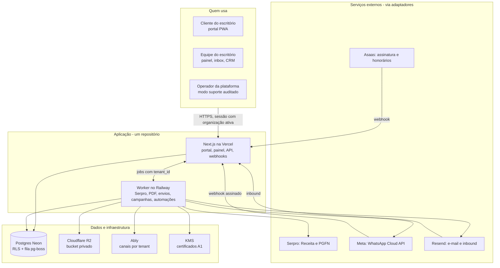

# Plano de Desenvolvimento — Plataforma Contábil Multi-tenant

Oct 14, 2026 · @Pedro

## 1. Resumo executivo

Vamos construir uma plataforma SaaS multi-tenant para escritórios de contabilidade. A Contact Consultoria é o primeiro tenant, assinando por R$ 500/mês. A mesma base atende outros escritórios sem reconstrução.

**Problema.** O escritório perde horas reenviando guias, recalculando boletos vencidos e mandando documentos que o cliente já recebeu. A conversa com o cliente fica espalhada no WhatsApp pessoal, sem histórico, funil ou automação.

**Usuários.** São três:

- **Equipe do escritório:** contadora, assistentes e atendentes.
- **Clientes do escritório:** as empresas atendidas, que usam o portal.
- **Operador da plataforma:** Pedro, com suporte e administração.

**Solução.** Um monólito modular com quatro frentes:

- **Entrega automática pelo WhatsApp do escritório (núcleo).** Guias com PDF, código de barras e Pix, documentos, links, avisos e cobranças (impostos e honorários). Tudo sai do número do próprio escritório, com templates mantidos pela plataforma.
- **CRM interno.** É a central de controle: a ficha de cada cliente e tudo o que foi enviado, entregue, lido, respondido e pago, além de conversas, solicitações e tarefas.
- **Motor fiscal.** Integração com a Receita via Serpro para gerar, recalcular e confirmar guias.
- **Cobrança de honorários.** Boleto e Pix na conta do próprio escritório, com baixa automática.
- **Portal do cliente (opcional).** Cada mensagem traz um link seguro que abre sem login. O portal completo existe para quem quiser acessar.

**Resultado esperado.** O cliente recebe tudo no WhatsApp sem ninguém do escritório enviar nada: a guia do mês, o lembrete, a guia atualizada quando vence, o documento pedido e a cobrança dos honorários. O escritório acompanha tudo no CRM e só entra quando o cliente precisa falar com uma pessoa. O tempo gasto com reenvio cai de \~8 h/mês para menos de 1 h/mês no tenant piloto (hipótese, medida no piloto).

**Decisão central.** Tudo nasce multi-tenant, com isolamento por organização tratado como requisito de segurança. Não fazemos um sistema de um cliente só para adaptar depois, porque isso custaria mais do que construir certo agora.

## 2. Confirmado, hipóteses e perguntas abertas

### Confirmado

- **Negócio:** a Contact aceitou a assinatura de cerca de R$ 500/mês. Tem menos de 25 clientes.
- **Pedidos da contadora:** portal com login, guias do mês, recálculo de guia vencida com um clique, parcelamentos, documentos da empresa e declaração de faturamento dos últimos 12 meses assinada.
- **Pedidos do Pedro:** multi-tenant, CRM no estilo Kommo com disparos de WhatsApp e e-mail, e chat de WhatsApp pela API oficial.
- **Preços da Serpro:** consulta R$ 0,24, emissão R$ 0,32 e declaração R$ 0,40 na faixa 1. Consulta de dívida ativa R$ 0,6591.
- **Sem API pública:** FGTS, ICMS-MA (DARE), ISS e parcelamento PGFN. Ficam em modo assistido.
- **Desenvolvimento:** solo, pelo Pedro, com Claude Code. Os sites de clientes ficam na Vercel, com DNS na Cloudflare.

### Hipóteses (validar)

- **H1.** A Contact tem e-CNPJ A1. Hoje ela entra no e-CAC com o certificado de cada cliente. Ela consegue gerar as procurações eletrônicas para o escritório (veja a seção 10).
- **H2.** Cerca de 25% das guias vencem e são recalculadas.
- **H3.** A maioria dos clientes prefere WhatsApp a e-mail.
- **H4.** Outros escritórios de São Luís pagariam R$ 300 a 600/mês pela plataforma.
- **H5.** Um escritório pequeno usa um único número de WhatsApp.

### Decisões tomadas em 14/10/2026

| # | Decisão | Onde muda o plano |
| --- | --- | --- |
| P1 | **Serpro:** o Pedro contrata o Integra Contador como software house, e o consumo entra nos planos. Escritório que já tiver contrato próprio pode cadastrar a conexão dele na tela Conexões. | Seção 10, conexão fiscal em dois modos |
| P2 | **WhatsApp:** cada escritório usa o próprio número e WABA, e a plataforma só intermedia (como no Kommo). No início a conexão é manual; depois da aprovação como Tech Provider, passa a ser por Embedded Signup. | Seção 10 |
| P3 | **Login do portal:** telefone e código no WhatsApp, com escolha da empresa. CNPJ e senha ficam como alternativa. | Seções 4 e 11 |
| P4 | **CRM interno:** serve só para os clientes atuais do escritório (ficha, atendimento, tarefas, equipe). Sem prospecção por enquanto. | Seções 3 e 4 |
| P5 | **Plano da Contact (R$ 500):** inclui inbox e CRM interno. Campanhas e automações ficam no plano superior. | Seção 8 (planos) |
| P6 | **Endereço:** subdomínio por escritório. | Seção 8 |
| P7 | **Nome e marca:** definir depois, antes do lançamento de março de 2027. | Seção 14 |

**Decisões complementares (14/10, tarde):**

| # | Decisão | Onde muda o plano |
| --- | --- | --- |
| P8 | **WhatsApp é o canal principal.** A entrega automática pelo número do escritório é o núcleo do produto. O portal é opcional, e cada mensagem leva um link seguro sem login. | Seções 1, 3, 4 e 14 |
| P9 | **Templates são da plataforma.** Nós escrevemos e mantemos a biblioteca, que é submetida automaticamente à Meta no WABA de cada escritório. O escritório ativa os templates, mas não cria template livre. | Seções 4, 5 e 10 |
| P10 | **Cobranças incluem guias e honorários.** O escritório cobra os próprios honorários por boleto e Pix, na conta de pagamento dele, com régua pelo WhatsApp. | Seções 4, 5, 9 e 10 |

| # | Decisão | Onde muda o plano |
| --- | --- | --- |
| P11 | **Automação primeiro.** Tudo o que a Serpro permite gerar ou consultar é feito automaticamente. A contadora só sobe arquivo quando não há integração (ICMS-MA, FGTS, ISS, PGFN), e mesmo esses fluxos são assistidos para dar o mínimo de trabalho. | Seções 3, 4 e 5 |

**Decisões da revisão do plano (14/10, noite):**

| # | Decisão | Onde muda o plano |
| --- | --- | --- |
| P12 | **ADRs.** São registrados os ADRs 0001 a 0009 (seção 16), incluindo 0008 (WhatsApp como canal principal) e 0009 (honorários na conta do escritório). | Seção 16 |
| P13 | **Autenticação com Auth.js.** O painel entra por link mágico no e-mail (provider Email, via Resend), com sessões guardadas no banco e revogáveis. Não há senha no painel. O provider Credentials não é usado, porque só funciona com sessão JWT, que não dá para revogar. | Seções 9, 11 e 16 (ADR 0007) |
| P14 | **MFA na Fundação.** TOTP obrigatório para dono e admin, opcional para contador e atendente, com códigos de recuperação. A sessão só vale depois do segundo fator (`mfa_verified`). Passkeys ficam para a fase "Segurança e piloto". | Seções 9, 11 e 14 |
| P15 | **Log de segurança separado da auditoria.** `audit_logs` (por tenant) guarda ações de negócio. `security_events` (global, só inserção pelo app) guarda acessos negados, buscas por ID sem resultado, logins falhos, webhooks inválidos e o modo suporte. | Seções 5 (CA1), 8, 9 e 11 |
| P16 | **Domínios.** O painel de todos os escritórios fica em `app.<domínio>`, e o portal e os links seguros ficam em `<slug>.<domínio>`. Os webhooks chegam em `app.<domínio>/api/webhooks/...`. Os cookies ficam presos ao host. O domínio próprio do escritório fica para depois do MVP. | Seções 8 e 13 |

## 3. Escopo

O MVP precisa provar uma coisa: o cliente da Contact recebe automaticamente, pelo WhatsApp do escritório, tudo o que antes era enviado à mão, e o escritório controla esses envios no CRM. A fundação multi-tenant entra já no MVP, porque não dá para adicioná-la depois com segurança.

**Princípio de automação:** se a Serpro permite gerar ou consultar, o sistema faz sozinho. Upload manual só existe para o que não tem integração, e mesmo assim com o máximo de preenchimento automático (seção 4, Matriz de automação).

### MVP: tenant piloto Contact (semanas 1 a 10)

- Fundação multi-tenant: organizações, membros, papéis, RLS e auditoria.
- Cadastro das empresas-clientes, com contatos, canal preferido, opt-in e documentos.
- Conexão do WhatsApp do escritório e biblioteca de templates da plataforma, submetida automaticamente à Meta.
- Geração automática de tudo o que a Serpro permite. Envio em lote de PDFs, com leitura de CNPJ, valor, vencimento e código de barras, só para o que não tem API. Nos dois casos, **entrega automática** pelo WhatsApp, com cópia por e-mail.
- Régua automática: guia disponível, lembrete, vencimento, guia vencida e pagamento confirmado.
- Links seguros sem login para cada guia, documento e cobrança, e portal básico com login (código no WhatsApp) para listar e baixar tudo o que foi disponibilizado.
- Integração Serpro: gerar e recalcular o DAS do Simples e do MEI, e consultar pagamentos.
- CRM interno: ficha 360, histórico de envios com status, inbox, solicitações, um funil de processo interno e tarefas.
- Cobrança de honorários: contrato por cliente, boleto e Pix na conta do escritório, régua e baixa automática.
- Fila de pedidos manuais (FGTS, ICMS, ISS, PGFN).

### Depois do MVP (semanas 11 a 20)

- Portal avançado: parcelamentos e declarações sob demanda, e preferências de aviso.
- Campanhas segmentadas e automações personalizadas (plano superior).
- Parcelamentos (PARCSN e PARCMEI), INSS (DCTFWeb), declaração de faturamento assinada e Radar de Débitos (situação fiscal e dívida ativa).
- Pedido de template novo pelo escritório, com revisão da plataforma.
- Onboarding de novos escritórios, planos, limites, medição de uso e cobrança da assinatura.

### Fora do escopo (por enquanto)

- Integração com sistemas contábeis (Domínio, Alterdata, Omie).
- Transmissão de declarações (PGDAS-D, DCTFWeb). O escritório continua transmitindo no sistema que já usa.
- Emissão de nota fiscal.
- Aplicativo nativo nas lojas. O portal é PWA.
- WhatsApp não oficial (Baileys, Evolution e similares).
- Atendente com IA. Fica planejado na seção 16, mas não é construído agora.
- Banco separado por tenant.

## 4. Módulos e requisitos funcionais

O sistema é dividido em nove módulos, com fronteiras claras dentro do mesmo código. A coluna Fase indica quando cada módulo entra.

| Módulo | O que faz | Fase |
| --- | --- | --- |
| Identidade e organizações | Login, organizações, membros, convites, papéis, troca de organização ativa, auditoria | MVP |
| Empresas-clientes | Cadastro (CNPJ, regime, sócios, contatos, canal preferido, opt-in), procuração e status | MVP |
| Documentos | Pastas por empresa, upload, versões, categorias e envio automático ao cliente | MVP |
| Guias | Guias por competência e tipo, geradas automaticamente pela Serpro quando há API; envio em lote com leitura de PDF só para o resto, status, Pix e código de barras, recálculo, fila manual | MVP |
| Entrega e templates | Biblioteca de templates da plataforma, régua automática, envio pelo WhatsApp do escritório com PDF e link seguro, cópia por e-mail, status de cada envio | MVP |
| Honorários | Contrato por cliente, boleto e Pix mensais na conta do escritório, régua de cobrança, baixa por webhook, recibo | MVP |
| Fiscal (Serpro) | DAS do Simples e do MEI, recálculo, pagamentos; depois parcelamentos, DCTFWeb, situação fiscal, dívida ativa e declaração de faturamento | MVP + depois |
| CRM e inbox | Ficha 360, histórico de envios, conversas em tempo real, solicitações, funis de processos, tarefas | MVP |
| Portal do cliente | Links seguros e portal básico com login, lista e download de tudo (MVP); recursos avançados (depois) | MVP + depois |
| Campanhas e automações personalizadas | Disparos segmentados e regras próprias do escritório | Depois (plano superior) |
| Plataforma | Planos, limites, medição de uso, cobrança da assinatura, modo suporte auditado | Depois |

### Fluxo central do sistema

O sistema trabalha numa ordem fixa: **coletar → organizar → vincular ao cliente certo → disponibilizar → enviar → acompanhar**. Nada chega ao cliente antes de estar guardado e vinculado.

1. **Coletar.** Rotinas agendadas e gatilhos consultam as APIs para cada empresa-cliente: guias, declarações, parcelamentos, pagamentos, situação fiscal, Caixa Postal (Serpro) e honorários (Asaas). Os arquivos do fluxo assistido entram por pasta, e-mail ou lote.
2. **Organizar e guardar.** Tudo vira registro padronizado (guia, documento, cobrança, pendência ou mensagem da Receita), com o PDF no armazenamento e com valor, vencimento, linha digitável e Pix extraídos.
3. **Vincular.** Cada item é ligado à empresa-cliente certa pelo CNPJ (e pela inscrição estadual, no ICMS), sempre dentro do tenant. O que não casar vai para revisão e nunca é enviado.
4. **Disponibilizar.** O item vinculado aparece no portal do cliente, pronto para ver e baixar, e na ficha da empresa no CRM.
5. **Enviar.** O que pode ir ao cliente (guias, documentos, honorários, declarações) sai pelo WhatsApp do escritório, com template, PDF e link, e cópia por e-mail. O que é só para o escritório (Caixa Postal, situação fiscal, débitos) vira alerta interno, e o escritório decide se avisa o cliente.
6. **Acompanhar.** Entrega, leitura, resposta e pagamento atualizam a ficha. A régua segue até o item ser pago ou substituído.

Cada etapa é um job idempotente com `tenant_id`. Se uma etapa falhar, o item para ali com o motivo visível no CRM, sem duplicar envios.

### Matriz de automação

A regra é tirar a contadora do caminho sempre que existir integração. Onde não existe, o sistema prepara tudo e ela só faz o passo que a lei ou o órgão exige.

| Item | Como entra no sistema | Trabalho da contadora |
| --- | --- | --- |
| DAS MEI | Serpro gera todo mês, sozinho | Nenhum |
| DAS Simples | O sistema monitora pela Serpro a declaração do mês (PGDAS-D). Assim que ela é transmitida, gera o DAS e envia ao cliente | Só transmitir a declaração, como já faz |
| Recálculo de DAS | Serpro, no clique do cliente | Nenhum |
| Parcelamentos do Simples e MEI | Serpro consulta e emite as parcelas | Nenhum |
| INSS (DCTFWeb) | Serpro emite a guia depois que a declaração é transmitida | Só transmitir, como já faz |
| DARFs federais (Sicalc) | Serpro | Nenhum, quando os dados já estão no sistema |
| Confirmação de pagamento | Serpro (consulta de pagamentos) | Nenhum |
| Situação fiscal e dívida ativa | Serpro, uma vez por mês e sob demanda | Nenhum |
| Caixa Postal da Receita | Serpro; o sistema destaca o que é importante | Ler só o que for destacado |
| Declaração de faturamento | Serpro (declarações do PGDAS-D) e assinatura local | Um clique para assinar |
| Honorários | Asaas, pela conta do escritório | Nenhum, depois de cadastrar o contrato |
| ICMS-MA (DARE) | Sem API: fluxo assistido (abaixo) | Emitir no dareweb, com tudo pré-preenchido |
| FGTS (FGTS Digital) | Sem API: fluxo assistido | Emitir no FGTS Digital |
| ISS São Luís | Sem API conhecida: fluxo assistido | Emitir no portal da prefeitura |
| Parcelamento PGFN | Sem API de emissão: fluxo assistido. A consulta de dívida ativa é automática | Emitir no Regularize |
| Documentos da empresa | Sobem uma vez e ficam disponíveis para sempre | Subir uma vez |

### Fluxo assistido (ICMS-MA, FGTS, ISS, PGFN)

Sem integração, o objetivo é reduzir o trabalho da contadora a emitir a guia no site do órgão.

1. **Fila do mês.** O sistema sabe quais clientes têm ICMS, FGTS ou ISS e mostra quem ainda está sem guia antes do vencimento.
2. **Dados prontos.** Cada item da fila traz inscrição estadual, código de receita, competência e vencimento para copiar. A contadora só informa o valor apurado, ou importa a apuração.
3. **Preenchimento com um clique (fase posterior).** Uma extensão do navegador preenche o formulário do dareweb com os dados do cliente e devolve o PDF gerado direto para o sistema. Ela continua clicando em "Gerar", sem robô rodando sozinho.
4. **Sem tela de upload.** Ela pode simplesmente salvar os PDFs numa pasta sincronizada ou encaminhar por e-mail para o endereço do escritório no sistema. O sistema lê, identifica o cliente, separa PDFs com várias guias e envia.
5. **Recálculo pedido pelo cliente.** Chega na fila já pré-preenchido com a nova data.
6. **Caminho oficial.** Consultar a SEFAZ-MA e o CRC-MA sobre webservice para escritórios. Se surgir, o ICMS-MA passa a automático sem mudar nada para o cliente.

### Entrega automática e biblioteca de templates

Este é o coração do produto. Tudo o que o escritório publica vira mensagem para o cliente, enviada pelo número do próprio escritório.

- **Biblioteca da plataforma.** Nós escrevemos, versionamos e mantemos os templates, todos na categoria utilidade. Quando o escritório conecta o WhatsApp, a plataforma submete a biblioteca à Meta no WABA dele e acompanha a aprovação. O escritório escolhe quais usar e só ajusta campos permitidos, como nome e assinatura.
- **Templates iniciais:**
  - guia disponível (PDF anexado, valor, vencimento, Pix e link seguro);
  - lembrete de vencimento;
  - guia vencida, com botão Atualizar guia;
  - guia atualizada;
  - pagamento confirmado;
  - documento disponível (PDF anexado);
  - declaração pronta;
  - honorário disponível (boleto em PDF, Pix e link);
  - lembrete e atraso de honorário;
  - aviso geral do escritório;
  - código de acesso (categoria autenticação).
- **Régua automática.** Os gatilhos do núcleo são fixos. Datas e horários são configuráveis por escritório.
  - Item publicado: envia.
  - Alguns dias antes do vencimento: lembra.
  - Vencido: oferece atualização ou segunda via.
  - Pago: confirma e para a régua.
- **Canal.** O WhatsApp é o padrão, com cópia opcional por e-mail. Se o WhatsApp falhar de forma permanente (número inválido ou sem opt-in), o envio vai por e-mail e o escritório é avisado no CRM.
- **Controle no CRM.** Cada envio fica na linha do tempo do cliente, com status (enfileirado, enviado, entregue, lido, respondido, falhou) e resultado (pago, baixado, atualizado).

### Cobrança de honorários

- **Conta do escritório.** O escritório conecta a própria conta de pagamento (Asaas no MVP) em **Conexões › Cobrança**. O dinheiro cai direto na conta dele; a plataforma nunca recebe nem repassa valores.
- **Contrato por cliente.** Cada cliente tem valor, dia de vencimento, reajuste e regra de multa e juros.
- **Ciclo mensal.** O sistema gera boleto e Pix, envia pelo WhatsApp com o PDF e o link, segue a régua e dá baixa quando o provedor confirma o pagamento.
- **Visão no CRM.** O escritório vê quem está em dia, quem atrasou e o histórico de cada cliente.

### Inbox e CRM, no estilo Kommo

- **Para quem é o CRM.** É interno: a central de controle dos clientes atuais do escritório e de tudo o que é enviado a eles. Prospecção e funil de vendas ficam fora por enquanto.
- **Ficha 360 da empresa-cliente.** Reúne dados cadastrais, sócios, contatos, regime, responsável no escritório, guias, honorários, documentos, conversas, tarefas e observações internas.
- **Histórico de envios.** Mostra cada guia, documento, link e cobrança enviados, com status de entrega, leitura, resposta e pagamento. Tem filtros como "guias não lidas" e "honorários em atraso".
- **Inbox unificado.** Cada conversa de WhatsApp ou e-mail fica ligada a um contato e à empresa-cliente dele.
- **Atendimento.** Atendentes pegam, transferem e encerram conversas. Há indicador de não lidas, entregue e lido, e notas internas que o cliente não vê.
- **Janela de 24h.** Mensagem livre só dentro da janela de 24h aberta pelo cliente. Fora dela, só template aprovado; a interface bloqueia o envio e oferece os templates.
- **Solicitações.** Um pedido do cliente (WhatsApp, e-mail ou portal) vira um item com responsável, prazo e status.
- **Funis de processos internos.** Kanban configurável para rotinas como onboarding de cliente novo, abertura ou alteração de empresa e regularização de pendências.
- **Linha do tempo do cliente.** Mensagens, e-mails, envios, pagamentos, documentos baixados, tarefas e mudanças de etapa.
- **Campanhas e automações personalizadas (plano superior).** Avisos segmentados para a carteira e regras próprias do escritório, além da régua automática do núcleo.

### Portal do cliente

- **Link seguro (MVP).** Cada mensagem traz um link exclusivo para a guia, o documento ou a cobrança. Ele abre sem login, mostra Pix, linha digitável e PDF, e tem o botão Atualizar guia. Expira em 30 dias, ou antes, quando o item é pago ou substituído.
- **Portal básico com login (MVP).** Entrada por código no WhatsApp e troca entre empresas. Lista tudo o que foi disponibilizado para a empresa (guias, documentos, honorários e declarações), pronto para baixar. Parcelamentos e declarações sob demanda vêm depois.
- **Portal é opcional.** Muitos clientes nunca vão abri-lo, e tudo continua funcionando pelo WhatsApp.
- **Preferências de aviso.** WhatsApp, e-mail ou os dois. O opt-out é respeitado em todos os envios.

## 5. Regras de negócio e critérios de aceitação

Toda regra abaixo é aplicada no servidor. A interface só reflete o que o servidor decidiu.

### Regras de negócio

- **RN1 — Status da guia.** As transições válidas são:
  - `rascunho → publicada → paga`
  - `publicada → vencida → substituída`
  - `publicada → cancelada`
  - Uma guia paga não volta a nenhum outro status.
- **RN2 — Recálculo automático.** Só vale para DAS (Simples e MEI) vencido e não pago. A nova guia substitui a anterior e guarda o vínculo de origem. Limite: 3 recálculos por guia por dia.
- **RN3 — Tipos assistidos.** FGTS, ICMS-MA, ISS e PGFN nunca chamam API externa. "Atualizar" cria um pedido na fila do escritório.
- **RN4 — Envio em lote.** Um PDF só é publicado se o CNPJ lido existir no tenant. Se a leitura falhar ou o CNPJ não for encontrado, o PDF vai para revisão manual e nada chega ao cliente.
- **RN5 — Duplicidade de guia.** Não pode haver duas guias ativas com a mesma chave `(tenant, empresa, tipo, competência)`.
- **RN6 — Janela de 24h.** Mensagem livre de WhatsApp só dentro de 24h da última mensagem do contato. Fora disso, só template aprovado.
- **RN7 — Consentimento.** Campanhas e lembretes só vão para contatos com opt-in ativo no canal. Opt-out ("SAIR" ou link no e-mail) vale na hora e fica registrado.
- **RN8 — Lembretes.** Guia paga não recebe lembrete. O status de pagamento é verificado imediatamente antes de cada envio.
- **RN9 — Acesso do portal.** A pessoa do portal só vê as empresas a que foi vinculada, e só dentro do tenant do domínio acessado.
- **RN10 — Papéis do escritório.**
  - **Dono:** pode tudo, inclusive certificados e cobrança.
  - **Admin:** configurações, usuários e campanhas.
  - **Contador:** guias, documentos e fiscal.
  - **Atendente:** inbox e CRM. Não vê certificados.
- **RN11 — Certificado digital.** No modo plataforma, o certificado do escritório nunca é enviado: só o dono assina o termo de autorização, localmente. No modo próprio, só o dono envia ou substitui o certificado. Certificados de clientes nunca são aceitos. A plataforma alerta 30, 7 e 1 dia antes do vencimento. Com termo ou certificado vencido, ações Serpro ficam bloqueadas e viram pedidos manuais.

* **RN12 — Templates.** Só são usados templates da biblioteca da plataforma, aprovados pela Meta no WABA do escritório. O escritório não cria template livre; pedidos de template novo passam por revisão da plataforma.
* **RN13 — Entrega automática.** Toda guia, documento ou cobrança publicada gera envio automático no canal preferido do cliente. Falha permanente no WhatsApp desvia para e-mail e cria alerta no CRM.
* **RN14 — Link seguro.** Cada item tem um token aleatório próprio, guardado só como hash. O link expira em 30 dias ou quando o item é pago ou substituído, tem limite de acessos e cada abertura é registrada.
* **RN15 — Honorários.**
  - A cobrança é gerada na conta de pagamento do próprio escritório; a plataforma não recebe nem repassa dinheiro.
  - Só existe uma cobrança por cliente e competência.
  - A baixa só acontece por confirmação do provedor (webhook) ou manualmente pelo escritório, com registro na auditoria.

- **RN16 — Automação primeiro.**
  - Para tipos com integração Serpro, o sistema não oferece upload como caminho padrão.
  - O upload só aparece como contingência, por exemplo com a Serpro fora do ar ou o termo vencido, e sempre fica registrado.
  - Tipos sem integração usam o fluxo assistido.

* **RN17 — Ordem do fluxo.** Um item só é disponibilizado ou enviado depois de guardado e vinculado a uma empresa-cliente do tenant. Item sem vínculo confirmado fica em revisão. Itens internos (Caixa Postal, situação fiscal) não são enviados ao cliente sem ação do escritório.

### Critérios de aceitação (exemplos-chave)

**CA1 — Isolamento entre escritórios**

- **Dado** um usuário do escritório A autenticado,
- **quando** ele pede a guia de ID X, que pertence ao escritório B,
- **então** o servidor responde 404,
- **e** não revela se X existe,
- **e** grava a tentativa em `security_events`.
- **Observação:** com RLS, o servidor não sabe (e não deve descobrir) se X é de outro tenant ou se não existe. Por isso, toda busca por ID sem resultado é registrada com usuário, tenant ativo, tipo de recurso, ID pedido e IP, e um alerta dispara por padrão (por exemplo, mais de 20 buscas sem resultado por minuto do mesmo usuário). O sistema nunca fura o RLS para descobrir o dono do recurso.

**CA2 — Recálculo de DAS**

- **Dado** um DAS vencido em 20/10 e não pago,
- **quando** o cliente toca em Atualizar guia em 22/10,
- **então** em até 15 s ele recebe a nova guia com vencimento 22/10 e valor atualizado pela Receita,
- **e** a guia anterior muda para `substituída`.
- **Falha:** se a Serpro não responder em 15 s, o cliente vê "Estamos gerando sua guia, ela chega no WhatsApp". O sistema tenta de novo em segundo plano até 3 vezes antes de abrir pedido na fila.

**CA3 — Envio em lote**

- **Dado** que a contadora sobe 30 PDFs,
- **quando** 28 têm CNPJ válido do tenant e 2 não,
- **então** 28 guias são publicadas e notificadas,
- **e** 2 aparecem em Revisão com o motivo,
- **e** nenhuma é publicada em duplicidade.

**CA4 — Janela de 24h**

- **Dado** um contato cuja última mensagem foi há 25h,
- **quando** o atendente tenta enviar texto livre,
- **então** o envio é bloqueado e a interface oferece os templates aprovados.

**CA5 — Opt-out em campanha**

- **Dado** um contato que respondeu SAIR,
- **quando** uma campanha é disparada para a tag dele,
- **então** ele é excluído do envio,
- **e** o relatório mostra o motivo "opt-out".

**CA6 — Pessoa em duas empresas**

- **Dado** que João é sócio da Padaria e da Loja, ambas no tenant Contact,
- **quando** ele entra no portal,
- **então** escolhe a empresa ativa,
- **e** nunca vê guias de uma empresa enquanto a outra está selecionada.

**CA7 — Entrega automática da guia**

- **Dado** que a contadora publicou um lote com a guia da Padaria,
- **quando** o processamento termina,
- **então** em até 2 min o contato da Padaria recebe, pelo número da Contact, o template "guia disponível" com o PDF, o Pix e o link seguro,
- **e** o CRM mostra o envio como entregue e depois como lido.

**CA8 — Honorário pago por Pix**

- **Dado** um honorário de outubro em aberto,
- **quando** o provedor confirma o pagamento por webhook,
- **então** a cobrança muda para paga, o cliente recebe o template "pagamento confirmado" e a régua daquele honorário para,
- **e** um webhook repetido não gera segunda baixa.

**CA9 — Template rejeitado**

- **Dado** que a Meta pausou o template "lembrete de vencimento" no WABA da Contact,
- **quando** chega a hora do lembrete,
- **então** o envio sai por e-mail,
- **e** o escritório vê um alerta com o motivo no CRM.

## 6. Requisitos não funcionais

As metas abaixo valem para até 20 escritórios e 2.000 empresas-clientes. Acima disso, revisamos a arquitetura.

| Categoria | Meta | Como medir |
| --- | --- | --- |
| Disponibilidade | 99,5% ao mês no portal e no inbox (cerca de 3,6 h de indisponibilidade) | Monitor externo a cada 1 min |
| Recuperação | RPO de 15 min (backup contínuo do Postgres); RTO de 4 h | Restauração testada a cada trimestre |
| Latência do portal | p95 abaixo de 800 ms nas páginas; abaixo de 1,5 s no primeiro carregamento em 4G | Métricas de servidor e Web Vitals |
| Inbox em tempo real | Mensagem recebida aparece para o atendente em até 3 s depois do webhook | Tempo entre webhook e entrega no socket |
| Recálculo | Guia nova em até 15 s no p95 (depende da Serpro) | Trace por chamada |
| Campanhas | 1.000 mensagens por hora por tenant, respeitando o tier da Meta, sem atrasar mensagens de atendimento | Fila separada por prioridade |
| Webhooks | Processados de forma idempotente; resposta 200 em até 2 s; trabalho pesado vai para a fila | ID do evento único por tenant |
| Acessibilidade | Portal WCAG 2.2 AA: contraste, teclado, leitor de tela | Verificação automática mais revisão manual |
| Mobile | Portal 100% funcional em 360 px de largura, instalável como PWA | Testes E2E em viewport móvel |
| Custo | Infraestrutura abaixo de R$ 50 por tenant por mês, sem contar Serpro e WhatsApp | Painel de custos mensal |
| Dados | Exportação completa do tenant (CSV e arquivos) em até 24 h; exclusão em até 30 dias depois do encerramento | Rotina documentada e testada |

## 7. Arquitetura proposta

A arquitetura é um monólito modular com dois processos do mesmo código. A **web** atende pessoas e recebe webhooks. O **worker** executa tudo o que é lento ou externo. O Postgres guarda dados e fila. Nenhuma requisição de usuário espera pela Serpro ou pela Meta sem prazo.

Os nomes de fornecedores são recomendações (ADRs 0003 e 0004) e podem ser trocados atrás dos adaptadores.

**Fluxo do recálculo:**

1. A web valida o tenant, a pessoa, a empresa e a guia.
2. A web cria o job com `tenant_id` e chave de idempotência.
3. O worker abre o certificado pelo KMS e chama a Serpro.
4. O worker grava a nova guia e o PDF no R2.
5. O worker publica o evento no canal do tenant no Ably e envia a guia pelo WhatsApp.

**Fluxo do inbox:**

1. A Meta chama o webhook.
2. A web confere a assinatura e mapeia o `phone_number_id` para o tenant.
3. A web grava o evento uma vez só e enfileira o job.
4. O worker cria a mensagem e a liga ao contato.
5. O worker avalia as automações e publica no canal do tenant.
6. O atendente vê a mensagem em até 3 s.

## 8. Estratégia multi-tenant

**Recomendação:** banco compartilhado e esquema compartilhado, com `tenant_id` em toda tabela de dados de escritório e Row-Level Security do Postgres como segunda barreira. O tenant é o escritório de contabilidade, e as empresas-clientes ficam dentro dele.

### Por que esse modelo

| Modelo | Isolamento | Custo e operação | Veredito |
| --- | --- | --- | --- |
| Banco e esquema compartilhados + RLS | Bom, com duas camadas (aplicação e banco) | Uma migração, um backup, barato | **Escolhido** para escritórios pequenos e médios |
| Esquema por tenant | Melhor | Migração × N esquemas, pool complexo | Não compensa para um dev solo |
| Banco por tenant | Máximo | Custo e operação multiplicados | Só se um contrato exigir |
| Híbrido | Flexível | Exige automação madura | Reavaliar com mais de 50 tenants ou um cliente grande |

### Atores e escopo

- **Operador da plataforma (Pedro):** sem acesso aos dados por padrão. Acesso excepcional é temporário, justificado e auditado ("modo suporte").
- **Membro do escritório:** usuário global com `membership` em um ou mais escritórios, com papel por escritório (RN10).
- **Usuário do portal:** pessoa vinculada a empresas-clientes de um tenant por `client_access`. Pode estar em empresas de escritórios diferentes; cada portal é separado pelo domínio.
- **Contato do CRM:** registro do tenant, sem login. Pode ou não ter acesso ao portal.

### Como o tenant é determinado

1. **Painel do escritório (`app.<domínio>`):** sessão autenticada com organização ativa. O servidor confere a membership a cada requisição e nunca aceita `tenant_id` vindo do navegador. Quem participa de dois escritórios troca a organização ativa sem trocar de endereço.
2. **Portal e links seguros (`<slug>.<domínio>`):** o subdomínio resolve o tenant no servidor, e a sessão do portal fica presa a esse tenant.
3. **Webhooks (`app.<domínio>/api/webhooks/...`):** o tenant vem do identificador do número ou domínio cadastrado, nunca do conteúdo da mensagem.

### Domínios e cookies

- **Domínio-base único**, lido de `APP_BASE_DOMAIN`. Trocar o domínio quando a marca sair (P7) é só configuração.
- **Slugs reservados:** `app`, `api`, `www`, `admin`, `status`, `mail`, `suporte`, `staging`, `docs`.
- **Cookies presos ao host** (sem `Domain=.<domínio>`), com `__Host-`, `Secure` e `SameSite=Lax`. A sessão de um subdomínio nunca vale em outro. O painel e o portal usam cookies com nomes diferentes.
- **Desenvolvimento:** `app.localhost:3000` e `<slug>.localhost:3000`, sem configurar DNS.
- **Staging:** domínio provisório comprado agora, até a marca definitiva.
- **Domínio próprio do escritório** (por exemplo, `portal.escritorio.com.br`): depois do MVP.
- **A verificar:** até onde se sabe, o certificado coringa (`*.<domínio>`) da Vercel exige que o DNS daquele domínio esteja nos nameservers da Vercel. Se for isso, só o domínio do produto vai para a Vercel, e os sites dos clientes continuam na Cloudflare.

### Logs de auditoria e de segurança

| Tabela | Escopo | O que guarda | Quem lê |
| --- | --- | --- | --- |
| `audit_logs` | tenant, com RLS | Ações de negócio: papéis, publicações, credenciais, configurações | Dono e admin do escritório |
| `security_events` | global, sem RLS | Acesso negado, busca por ID sem resultado, login falho, MFA falho, webhook com assinatura inválida, uso do modo suporte | Só o operador, por um papel de leitura separado |

- O papel `app` só tem `INSERT` em `security_events`. Não tem `SELECT`, `UPDATE` nem `DELETE`.
- O modo suporte grava nas duas tabelas: em `security_events` para o operador e em `audit_logs` do tenant, para o escritório ver quem acessou, quando e por quê.
- Só identificadores entram no log, nunca o conteúdo da requisição. A retenção é de 1 ano.
4. **Jobs:** todo job carrega `tenant_id` no payload. O worker abre a transação com o contexto do tenant, e um job sem tenant falha antes de executar.

### Isolamento por camada

| Camada | Controle |
| --- | --- |
| API e casos de uso | Middleware estabelece o `TenantContext`; repositórios só funcionam com ele; consulta sem tenant não compila nem roda |
| Banco | RLS em todas as tabelas de tenant, com `SET LOCAL app.tenant_id` por transação (seguro com pool); chaves compostas `(tenant_id, id)` e estrangeiras compostas |
| Arquivos | Bucket privado, caminho `tenants/{tenant_id}/...`; URL assinada de 5 min gerada só depois da checagem de permissão |
| Cache e tempo real | Chaves e canais prefixados com o tenant; o canal do socket é autorizado no servidor |
| Filas e jobs | `tenant_id` obrigatório; limite de concorrência por tenant |
| Busca | Toda busca filtra por tenant no índice; sem índice global |
| Logs e métricas | `tenant_id` como campo, sem conteúdo de mensagens nem documentos; o painel do operador mostra agregados |
| Integrações | Credenciais (Serpro, WhatsApp, e-mail) guardadas por tenant e criptografadas |

### Ciclo de vida do tenant

- **Estados:** `trial` → `active` → `past_due` → `suspended` → `closed`.
  - Em `past_due`, tudo funciona e um aviso aparece.
  - Em `suspended`, o portal fica só leitura e disparos e automações param.
  - Em `closed`, a exportação fica disponível por 30 dias e depois os dados são excluídos.
- **Provisionamento:**
  1. Criar organização e convite do dono.
  2. Configurar subdomínio.
  3. Conectar WhatsApp e e-mail.
  4. Enviar certificado.
  5. Importar empresas por CSV.
- **Planos:** a política de limites fica centralizada (`entitlements`): empresas-clientes, usuários, números de WhatsApp, campanhas por mês e módulos fiscais. O uso de Serpro e de mensagens é medido por tenant.

## 9. Modelo de dados preliminar

São cerca de 30 tabelas em seis grupos. Escopo **global** significa sem tenant. Escopo **tenant** significa `tenant_id NOT NULL`, RLS ativo e chave composta `(tenant_id, id)`.

| Grupo | Tabela | Escopo | Campos e restrições principais |
| --- | --- | --- | --- |
| Identidade | `users` | global | e-mail e telefone únicos; sem senha (login por link mágico); segredo TOTP cifrado, obrigatório para dono e admin |
| Identidade | `accounts`, `sessions`, `verification_tokens` | global | tabelas do Auth.js; sessão no banco, revogável, com `mfa_verified` e organização ativa |
| Identidade | `mfa_recovery_codes` | global | códigos de recuperação com hash, uso único |
| Identidade | `security_events` | global | tipo, usuário, tenant ativo, recurso e ID pedido, IP, data; somente inserção pelo app, leitura só pelo operador |
| Identidade | `tenants` | global | nome, slug único, domínio, status, plano |
| Identidade | `memberships` | tenant | `(tenant_id, user_id)` único, papel |
| Identidade | `invitations` | tenant | token com hash, expira em 72 h, uso único |
| Identidade | `tenant_settings`, `entitlements`, `usage_counters` | tenant | limites do plano; contadores por mês e recurso |
| Identidade | `audit_logs` | tenant | ator, ação, recurso, IP; somente inserção |
| Escritório | `client_companies` | tenant | `(tenant_id, cnpj)` único, regime (SN, MEI, LP, LR), status da procuração |
| Escritório | `portal_users`, `client_access` | tenant | pessoa do portal ↔ empresa; `(tenant_id, portal_user_id, company_id)` único |
| Escritório | `documents`, `document_versions` | tenant | categoria, empresa, chave no storage, hash do arquivo |
| Escritório | `credentials` | tenant | tipo (termo Serpro assinado, e-CNPJ só no modo próprio, WhatsApp, e-mail), conteúdo criptografado, validade |
| Guias | `guides` | tenant | tipo, competência, vencimento, valor, linha digitável, Pix, status; único `(tenant_id, company_id, type, period)` entre as ativas |
| Guias | `guide_events` | tenant | transições de status, quem e quando |
| Guias | `guide_requests` | tenant | pedido manual (tipos assistidos), responsável, SLA |
| Guias | `installment_plans`, `installments` | tenant | parcelamento, parcelas, origem (PARCSN, PARCMEI, PGFN) |
| Guias | `fiscal_calls` | tenant | chamada Serpro, serviço, custo, status, chave de idempotência |
| Guias | `batch_uploads` | tenant | lote, arquivos, resultado da leitura, pendências |
| CRM | `contacts` | tenant | nome, telefone E.164, e-mail; `(tenant_id, phone)` único; opt-in por canal |
| CRM | `pipelines`, `stages`, `deals` | tenant | funil, etapas ordenadas, negócio com valor, responsável, etapa |
| CRM | `tasks`, `notes`, `tags`, `custom_fields`, `custom_field_values` | tenant | campos personalizados com tipo |
| CRM | `activities` | tenant | linha do tempo unificada (mensagem, guia, documento, etapa) |
| Mensagens | `channels` | tenant | número de WhatsApp ou domínio de e-mail; `phone_number_id` único global (mapeia o webhook para o tenant) |
| Mensagens | `conversations` | tenant | contato, canal, atendente, status, início da janela de 24 h |
| Mensagens | `messages` | tenant | direção, tipo, conteúdo, anexos, status da Meta; `(tenant_id, provider_message_id)` único |
| Mensagens | `templates` | tenant | nome, idioma, categoria, status de aprovação na Meta |
| Mensagens | `campaigns`, `campaign_recipients` | tenant | segmento, agendamento, limite de envio, status por destinatário |
| Mensagens | `automations`, `automation_runs` | tenant | gatilho, condições, ações (JSON validado); execuções com resultado |
| Plataforma | `webhook_events` | tenant | ID externo único, payload, processado em |
| Plataforma | `subscriptions`, `invoices` | tenant | plano, ciclo, status de pagamento |

**Tabelas de entrega e honorários:**

| Tabela | Escopo | Campos e restrições principais |
| --- | --- | --- |
| `template_library` | global | nome, categoria Meta, idioma, corpo, variáveis, cabeçalho (documento ou texto), botões, versão; mantida só pela plataforma |
| `tenant_templates` | tenant | template da biblioteca ↔ WABA do escritório; status na Meta, ID do template na Meta, ativo; `(tenant_id, library_id, version)` único |
| `deliveries` | tenant | item enviado (guia, documento, honorário, aviso), canal, template, status, tentativas, motivo da falha; liga à mensagem e ao contato |
| `secure_links` | tenant | hash do token, item, expira em, revogado em, contador de acessos |
| `fee_contracts` | tenant | empresa, valor em centavos, dia de vencimento, multa e juros, reajuste, ativo |
| `fee_charges` | tenant | contrato, competência, valor, vencimento, status, ID no provedor, linha digitável, Pix; `(tenant_id, company_id, period)` único |

**Regras de modelagem:**

- IDs são UUID v7, ordenáveis.
- Valores ficam em centavos (`bigint`).
- Datas ficam em `timestamptz`. Competência é `date`, sempre no dia 1.
- Exclusão é lógica (`deleted_at`) nas tabelas de negócio, com rotina de exclusão definitiva para LGPD.
- Migrações são versionadas e aplicadas no pipeline antes do deploy. Política "expandir → migrar → contrair" para mudanças compatíveis.
- Nenhum dado de produção vai para desenvolvimento. O seed usa dados fictícios.

## 10. Integrações externas

Todas as integrações passam por um adaptador próprio, chamado pelos casos de uso e nunca direto da interface. Cada adaptador tem timeout, retentativa com backoff, idempotência e registro de custo por tenant.

| Integração | Uso | Autenticação | Pontos de atenção |
| --- | --- | --- | --- |
| Serpro Integra Contador | DAS do Simples e do MEI, recálculo, pagamentos, parcelamentos, DCTFWeb, situação fiscal, Caixa Postal | OAuth2 com mTLS usando o certificado do contratante; procuração eletrônica do contribuinte para o escritório | Cobrado por chamada (consulta R$ 0,24, emissão R$ 0,32); dois modos de conexão (abaixo); instabilidade em períodos de pico |
| Serpro Consulta Dívida Ativa | Radar de Débitos (PGFN) | Credencial Serpro | R$ 0,6591 por consulta na faixa 1; produto contratado à parte |
| WhatsApp Cloud API (Meta) | Inbox, templates, lembretes, campanhas, bot | Token do sistema por WABA; webhook com assinatura `X-Hub-Signature-256` | Cada escritório tem número e WABA próprios; templates aprovados pela Meta; janela de 24 h; tiers de envio; cobrança por mensagem entregue |
| E-mail transacional e de campanha (Resend ou Amazon SES) | Lembretes, cópias de guias, campanhas, inbox de e-mail | Chave de API; domínio de cada escritório verificado com DKIM, SPF e DMARC | E-mail de entrada para o inbox via webhook de inbound; reputação separada por domínio |
| Armazenamento (Cloudflare R2 ou S3) | PDFs de guias, documentos, anexos do WhatsApp | Chaves só no servidor | Bucket privado, URLs assinadas, criptografia em repouso, versionamento |
| Pix e código de barras | Exibir o Pix e a linha digitável da guia | Sem integração bancária | O Pix vem do PDF ou da resposta da Serpro; a plataforma só exibe e não movimenta dinheiro |
| Leitura de PDF | Envio em lote: CNPJ, valor, vencimento, código de barras | Biblioteca local (pdf.js ou pdfplumber) com regex por modelo de guia | OCR só como plano B para PDF escaneado; leitura incerta vai para revisão |
| Assinatura digital | Declaração de faturamento | e-CPF A1 do contador (PAdES) | O cliente assina depois pelo gov.br; validar aceitação pelos bancos |
| Cobrança da plataforma (Asaas ou similar) | Assinatura mensal dos escritórios | Chave de API e webhook | Depois do MVP; a Contact paga por boleto manual no início |

### Conexão fiscal (Serpro): dois modos por escritório

A tela **Conexões › Receita Federal** mostra o modo escolhido, a validade do certificado, um botão "Testar conexão" (faz uma consulta barata) e o consumo do mês.

1. **Modo plataforma (padrão, incluso no plano).**
   - O Pedro é o contratante do Integra Contador, como software house. O escritório entra como autor do pedido e procurador dos clientes.
   - O escritório autoriza a plataforma assinando o termo de autorização (serviço Autentica Procurador) com o e-CNPJ instalado no computador dele. O certificado nunca é enviado. No MVP, a assinatura é feita no Assinador do Serpro, que é gratuito, e só o arquivo assinado sobe para o sistema. Depois, vira um clique no navegador via Web PKI. O termo tem validade, e o sistema avisa antes de vencer para assinar de novo.
   - O consumo é medido por tenant. O plano tem uma franquia de chamadas; o que passar disso é cobrado por chamada.
2. **Modo próprio.**
   - O escritório que já tem contrato com a Serpro cadastra consumer key, consumer secret e o certificado e-CNPJ (.pfx e senha).
   - O custo fica no contrato do escritório, e a plataforma não cobra franquia.

Nos dois modos o adaptador é o mesmo. Muda só de onde vêm as credenciais, sempre cifradas por tenant.

**Procurações dos clientes.** Hoje a Contact entra no e-CAC com o certificado de cada cliente. Para a plataforma, o caminho é cada cliente outorgar procuração eletrônica ao CNPJ do escritório no e-CAC. A Maria Clara faz isso sozinha, uma vez por cliente, com o certificado que já usa. Assim a plataforma guarda apenas o certificado do escritório, nunca o de cada cliente. Guardar certificados de clientes está fora do escopo, porque multiplica o risco sem necessidade.

**A validar na PoC:**

- Emitir um DAS no modo plataforma com o termo da Contact.
- Medir a validade do token do procurador.
- Confirmar que a tarifa é cobrada no CNPJ do contratante.

### Conexão do WhatsApp: cada escritório com o próprio WABA

Como no Kommo, o número e a conta WhatsApp Business (WABA) são do escritório, e a plataforma só intermedia. A Meta cobra as mensagens direto no meio de pagamento do escritório.

1. **Agora: conexão manual.**
   - A tela **Conexões › WhatsApp** pede o WABA ID, o Phone Number ID, o token permanente de usuário do sistema e o app secret.
   - A plataforma mostra a URL de webhook e o token de verificação exclusivos do tenant, para colar no app da Meta do escritório. A assinatura de cada webhook é validada com o app secret.
   - O Pedro faz isso junto com a Contact no onboarding. Não depende da aprovação de Tech Provider.
2. **Depois: Embedded Signup.** Com a aprovação de Tech Provider, o botão "Conectar WhatsApp" abre o fluxo da Meta e preenche tudo sozinho. O adaptador e as tabelas são os mesmos.

A biblioteca de templates é da plataforma (seção 4). Quando o escritório conecta o número, o sistema submete todos os templates ativos ao WABA dele pela API e acompanha o status de aprovação. Se a Meta rejeitar ou pausar um template, aquele tipo de envio passa a sair por e-mail e o escritório é avisado.

### Conexão de cobrança (honorários)

- **Provedor no MVP.** Asaas, com a conta do próprio escritório. A chave de API é cadastrada em Conexões › Cobrança e fica cifrada por tenant. Outros provedores, como Inter ou Itaú, entram depois atrás do mesmo adaptador.
- **Fluxo.**
  1. Gerar a cobrança com boleto e Pix.
  2. Enviar pelo WhatsApp com PDF e link.
  3. Receber o webhook de pagamento.
  4. Dar baixa, enviar recibo e parar a régua.
- **Idempotência.** Uma cobrança por `(tenant, empresa, competência)`. Cada webhook tem ID único e é processado uma vez só.
- **Custos.** As tarifas do provedor ficam com o escritório. A plataforma não guarda dinheiro de ninguém, o que evita as exigências de instituição de pagamento.

**Próximo passo:** abrir a verificação de Tech Provider assim que o MEI estiver ativo. Até lá, a conexão manual atende a Contact e os primeiros escritórios.

### Idempotência e confiabilidade

- **Webhooks recebidos:** gravados em `webhook_events` com ID externo único. Se chegar repetido, o sistema ignora. A resposta é 200 imediata e o processamento vai para a fila.
- **Chamadas Serpro de emissão:** chave de idempotência `(tenant, empresa, tipo, competência, data de vencimento)`. Um duplo clique não gera duas cobranças.
- **Envio de mensagens:** status `queued → sent → delivered → read` ou `failed`. Erros temporários têm até 5 retentativas com backoff. Erros permanentes, como número inválido ou opt-out, não são reenviados.
- **Disjuntor (circuit breaker):** se a Serpro falhar 5 vezes seguidas em 1 min, novos recálculos vão direto para a fila manual com aviso, até o serviço voltar.

## 11. Segurança e LGPD

O ativo mais sensível é o certificado digital. A regra é: **o certificado do escritório e os dos clientes ficam no computador do escritório**. O único certificado no servidor é o do contratante Serpro (Pedro), cifrado no KMS e usado só pelo worker.

| Certificado | Onde fica | Uso |
| --- | --- | --- |
| e-CNPJ do Pedro (contratante Serpro) | Servidor, cifrado com KMS | Conexão mTLS com a Serpro |
| e-CNPJ do escritório | Computador do escritório (A1 instalado ou A3) | Assinar localmente o termo de autorização e a declaração de faturamento |
| Certificados dos clientes | Computador do escritório | Gerar, uma vez, a procuração eletrônica no e-CAC para o CNPJ do escritório |
| e-CNPJ do escritório no modo próprio | Servidor, cifrado com KMS | Exceção, só para quem tem contrato Serpro próprio |

### Ameaças principais e controles

| Ameaça | Controle |
| --- | --- |
| Vazamento do certificado do contratante (ou do escritório no modo próprio) | Criptografia em envelope: chave mestra no KMS ou cofre, chave de dados por tenant. Certificado decifrado só em memória, no worker fiscal. Nunca em log, interface ou backup sem cifra. Troca e uso auditados |
| Acesso cruzado entre escritórios (IDOR/BOLA) | Contexto de tenant obrigatório, RLS e respostas 404 sem detalhe (seção 8); testes negativos no CI |
| Tomada de conta | Painel sem senha (link mágico de uso único e curta duração), TOTP obrigatório para dono e admin, limite de tentativas, sessões no banco e revogáveis, alerta de novo dispositivo, eventos em `security_events` |
| Login do portal por CNPJ | CNPJ é público; então exige senha forte ou código de uso único no WhatsApp, limite de tentativas por CNPJ e por IP, sem revelar se o CNPJ existe |
| Webhook forjado | Validação da assinatura da Meta e do provedor de e-mail; rejeitar sem assinatura |
| Abuso de campanhas (spam) | Opt-in obrigatório, limite por tenant, bloqueio automático se a qualidade do número cair na Meta |
| Injeção, XSS, CSRF | ORM com parâmetros, validação com schema em toda entrada, escape no front, cookies `SameSite` e token CSRF, CSP restritiva |
| SSRF em anexos e links | Download de mídia só de domínios da Meta e do provedor; sem buscar URLs livres enviadas por usuários |
| PDF malicioso | Limite de tamanho (10 MB), checagem de tipo pelo conteúdo, leitura em processo isolado, sem execução de scripts |
| Dependência vulnerável | Dependabot ou Renovate, auditoria no CI, lockfile versionado |

### LGPD

- **Papéis:** o escritório é o **controlador** dos dados dos clientes dele. A plataforma do Pedro é a **operadora**. Assinar um contrato de tratamento de dados (DPA) com cada escritório.
- **Dados tratados:** CNPJ, CPF de sócios, telefone, e-mail, documentos societários, declarações de IR e valores de impostos. Todos são dados pessoais e financeiros sensíveis ao negócio.
- **Minimização:** não guardar mais do que o necessário; mensagens e documentos só no tenant.
- **Consentimento:** opt-in de WhatsApp e e-mail registrado com data e origem; opt-out imediato.
- **Direitos do titular:** exportação e exclusão por contato e por tenant; atendimento em até 15 dias.
- **Retenção:** documentos fiscais pelo prazo que o escritório definir (padrão de 5 anos); logs de auditoria por 1 ano; backups por 30 dias.
- **Suboperadores:** listar publicamente (provedor de nuvem, Meta, provedor de e-mail, Serpro) e informar mudanças.
- **Incidentes:** plano de resposta com comunicação ao escritório em até 24 h. A comunicação à ANPD fica a cargo do controlador.

**Validação especializada:** os termos de uso, o DPA e a política de privacidade devem ser revisados por um advogado antes de vender a outros escritórios.

## 12. Estratégia de testes

Os testes de isolamento entre tenants bloqueiam o merge desde o primeiro dia. Vazamento entre escritórios é o defeito mais grave possível neste produto.

| Nível | O que cobre | Quando roda | Bloqueia |
| --- | --- | --- | --- |
| Unitário | Regras de status da guia, cálculo de janela de 24 h, leitura de PDF por modelo, avaliação de automações, política de limites | Cada commit | Merge |
| Integração | Banco real (Postgres em container) com RLS, filas, storage, autenticação | Cada PR | Merge |
| Contrato | Adaptadores Serpro, Meta e e-mail com respostas gravadas da sandbox; payloads de webhook reais | Cada PR + semanal contra sandbox | Merge |
| Isolamento multi-tenant | Lista abaixo, com dois tenants semeados | Cada PR | Merge |
| E2E (Playwright) | Login, envio em lote → cliente vê guia → atualiza → paga; inbox recebe e responde; campanha com opt-out | Cada PR em staging | Deploy |
| Segurança | SAST, auditoria de dependências, varredura de segredos, cabeçalhos e CSP | Cada PR | Merge |
| Performance | 1.000 webhooks por minuto; campanha de 5.000 mensagens sem atrasar o inbox | Antes de cada marco | Lançamento |
| Resiliência | Serpro fora do ar, timeout, webhook duplicado, worker reiniciado no meio do job | Antes de cada marco | Lançamento |
| Restauração | Restaurar backup em ambiente limpo e conferir integridade | Trimestral | — |

### Testes negativos de isolamento (obrigatórios)

- Usuário do tenant A lê, edita e exclui guia, documento, contato, conversa e campanha do tenant B: sempre 404, sem efeito no banco.
- ID trocado manualmente na URL e no corpo (IDOR/BOLA) em todos os endpoints. Gerado automaticamente a partir da lista de rotas.
- Membro de dois escritórios troca a organização ativa e não enxerga dados da anterior em listas, cache ou socket.
- Pessoa do portal vinculada à empresa X não acessa a empresa Y do mesmo tenant.
- Portal acessado pelo domínio do tenant A com sessão do tenant B: sessão rejeitada.
- Job sem `tenant_id`: falha antes de executar. Job com tenant errado: RLS bloqueia a escrita.
- Conexão do pool reutilizada não mantém o `app.tenant_id` da transação anterior.
- URL assinada de documento do tenant A não é gerada para usuário do tenant B, e expira em 5 min.
- Webhook com `phone_number_id` do tenant A nunca cria mensagem no tenant B.
- Busca, exportação, relatório e campanha nunca misturam tenants.
- Canal de tempo real de outro tenant: inscrição negada.
- Modo suporte do operador: só com justificativa, expira em 1 h e gera log de auditoria.

Cada teste verifica a resposta HTTP **e** o estado do banco, dos arquivos e dos logs.

## 13. Operação

A operação precisa caber na rotina de um desenvolvedor solo: tudo gerenciado, sem servidor para manter na mão, e com alertas que só tocam quando alguém precisa agir.

### Ambientes e entrega

- **Ambientes:** `local` (Docker com Postgres), `staging` (dados fictícios, sandbox da Serpro e número de teste do WhatsApp) e `production`.
- **Repositório:** monorepo com `apps/web` (Next.js), `apps/worker` e `packages/*` (domínio, banco, adaptadores). Usa lint, formatação, TypeScript estrito e conventional commits.
- **CI no GitHub Actions:** testes, verificações de segurança e testes de isolamento a cada PR. O deploy em staging é automático; a produção recebe deploy por tag, após o E2E passar em staging.
- **Migrações:** rodam antes do deploy do app e seguem o padrão expandir → migrar → contrair. Toda migração tem script de rollback ou um plano de recuperação escrito.
- **Rollback:** fica a um clique na Vercel e no Railway. Feature flags por tenant permitem ligar módulos aos poucos.
- **Segredos:** ficam em variáveis de ambiente dos provedores, nunca no repositório. A chave mestra dos certificados fica no KMS. A rotação de chaves é documentada.

### Observabilidade

- **Erros:** Sentry no web e no worker, com `tenant_id` como tag e sem conteúdo de mensagens.
- **Logs:** estruturados em JSON (Better Stack ou Axiom), com `request_id`, `tenant_id`, `job_id` e retenção de 30 dias.
- **Métricas por tenant:**
  - Guias publicadas, recalculadas e pagas.
  - Chamadas e custo da Serpro.
  - Mensagens por status.
  - Fila pendente.
  - Tempo do webhook até o inbox.
- **Alertas:**
  - Taxa de erro da Serpro acima de 20%.
  - Fila de jobs atrasada mais de 5 min.
  - Webhooks falhando.
  - Certificado vencendo.
  - Qualidade do número do WhatsApp caindo.
  - Backup falhou.
- **Uptime:** monitor externo do portal, da API e do endpoint de webhook, com página de status simples.

### Backup e recuperação

- **Postgres:** PITR de 7 dias (Neon ou equivalente) mais dump diário cifrado guardado em outro provedor.
- **Arquivos:** versionamento no bucket mais cópia semanal para outra conta.
- **Teste de restauração:** trimestral, com tempo medido contra o RTO de 4 h.

### Runbooks (procedimentos escritos)

1. Serpro fora do ar: ativar o disjuntor, avisar os escritórios e reprocessar a fila quando o serviço voltar.
2. Template rejeitado ou número com qualidade baixa na Meta.
3. Certificado vencido ou senha errada.
4. Webhook parado: reprocessar eventos a partir do painel da Meta.
5. Suspeita de acesso indevido: revogar sessões, girar credenciais e acionar o plano de incidente.
6. Restaurar o backup de um tenant (rotina por `tenant_id`).

### Suporte

O canal de suporte do escritório é o próprio WhatsApp do Pedro, com SLA de resposta em horário comercial. Os defeitos são registrados em issues do GitHub com prioridade: P1 (vazamento ou sistema fora do ar), P2 (função quebrada) e P3 (melhoria).

## 14. Plano de execução

O plano tem três marcos:

- **23/11 — Entrega automática no ar.** A Contact passa a enviar guias pelo WhatsApp, cumprindo o prazo de 5 semanas combinado.
- **28/12 — MVP completo.** Inclui inbox, CRM, Serpro e honorários.
- **Março de 2027 — Venda a outros escritórios.** A plataforma fica pronta para novos clientes.

| Incremento / marco | Início | Fim |
| --- | --- | --- |
| Descoberta e PoCs | 19/10/2026 | 02/11/2026 |
| Fundação multi-tenant | 26/10/2026 | 09/11/2026 |
| Clientes e documentos | 02/11/2026 | 16/11/2026 |
| Guias, templates e entrega | 09/11/2026 | 23/11/2026 |
| **Marco: entrega automática no ar (Contact)** | **23/11/2026** | |
| Inbox, CRM e solicitações | 23/11/2026 | 14/12/2026 |
| Serpro: DAS e recálculo | 07/12/2026 | 21/12/2026 |
| Honorários e portal básico | 14/12/2026 | 28/12/2026 |
| **Marco: MVP completo** | **28/12/2026** | |
| Campanhas e automações | 04/01/2027 | 25/01/2027 |
| Fiscal completo | 11/01/2027 | 08/02/2027 |
| Portal com login e planos | 01/02/2027 | 22/02/2027 |
| Segurança e piloto | 15/02/2027 | 08/03/2027 |
| **Marco: venda a novos escritórios** | **08/03/2027** | |

A semana de 28/12 fica livre por causa das festas. Ela funciona como folga do MVP. Cada incremento entrega algo que dá para ver funcionando.

| Incremento | Entrega observável | Pronto quando |
| --- | --- | --- |
| Descoberta e PoCs | Serpro respondendo com o termo da Contact; mensagem de WhatsApp enviada e recebida por webhook; templates de teste aprovados; 20 PDFs reais lidos | Taxa de leitura de PDF acima de 90%; PoC Serpro concluída |
| Fundação multi-tenant | Login por link mágico, TOTP para dono e admin, dois escritórios de teste, convites, papéis, RLS, auditoria, `security_events`, subdomínios, CI | Todos os testes negativos de isolamento passando |
| Clientes e documentos | Importação por CSV; ficha do cliente; pastas por empresa | CA6 passando; arquivo de outro tenant inacessível |
| Guias, templates e entrega | WhatsApp da Contact conectado e biblioteca aprovada; a contadora sobe o lote e cada cliente recebe a guia no WhatsApp com PDF, Pix e link seguro; régua ativa | CA3 e CA7 passando; piloto com 5 clientes |
| Inbox, CRM e solicitações | Histórico de envios por cliente; conversa em tempo real; solicitações e tarefas | CA4 e CA5 passando; inbox abaixo de 3 s |
| Serpro: DAS e recálculo | Atualizar guia gera DAS novo e o envia; confirmação de pagamento | CA2 passando; disjuntor testado |
| Honorários e portal básico | Contratos de honorários; boleto e Pix na conta da Contact; régua e baixa automática; portal básico com lista e download | CA8 passando; um mês real de honorários cobrado |
| Campanhas e automações | Disparo segmentado; regras personalizadas do escritório | 5.000 mensagens sem atrasar o inbox nem a régua |
| Fiscal completo | Parcelamentos, DCTFWeb, declaração de faturamento assinada, Radar de Débitos | Declaração aceita por um banco real |
| Portal com login e planos | Portal com histórico; novo escritório se cadastra, conecta WhatsApp e cobrança e paga a assinatura | Onboarding sem ajuda do Pedro em até 1 h |
| Segurança e piloto | Revisão de segurança, teste de carga, restauração de backup, 2º escritório piloto | Nenhum P1 aberto; RTO medido abaixo de 4 h |

### Definição de pronto (vale para todo item)

- [ ] Critérios de aceitação atendidos e cobertos por teste automatizado.
- [ ] Autorização checada no backend e teste negativo de isolamento escrito.
- [ ] Erros, timeouts e estados vazios tratados, com mensagem clara para o usuário.
- [ ] Migração revisada, com rollback ou plano de recuperação.
- [ ] Logs e métricas úteis, sem conteúdo sensível.
- [ ] Funciona em 360 px e com teclado.
- [ ] Deploy em staging aprovado e E2E verde.
- [ ] Documentação e runbook atualizados quando houver integração nova.

## 15. Riscos prioritários

O risco que mais preocupa é o de escopo, não o técnico. Um CRM completo no estilo Kommo é um produto inteiro por si só, e ele foi somado a uma assinatura de R$ 500. Os dois primeiros itens da tabela tratam disso. O responsável por todos os riscos é o Pedro.

| # | Risco | Prob. | Impacto | Sinal de alerta | Mitigação | Plano B |
| --- | --- | --- | --- | --- | --- | --- |
| R1 | Escopo do CRM cresce e atrasa o portal prometido à Contact | Alta | Alto | Semana 6 sem portal no ar | MVP com CRM básico; o CRM completo só vem depois do piloto; congelar o escopo a cada incremento | Entregar o portal primeiro e o inbox em seguida, mesmo sem funil |
| R2 | Receita da Contact (R$ 500) não paga o esforço de um SaaS | Alta | Alto | Mais de 20 semanas sem um segundo escritório | Validar H4 cedo: mostrar o piloto a 3 escritórios até a semana 12 | Manter o produto só para a Contact e reduzir o escopo do CRM |
| R3 | Vazamento de dados entre escritórios | Baixa | Crítico | Teste de isolamento falhando, alerta de RLS | RLS, contexto obrigatório, testes negativos no CI, revisão de código de todo acesso a dados | Plano de incidente e comunicação em até 24 h |
| R4 | Vazamento do certificado do contratante (Pedro) | Baixa | Crítico | Uso fora do padrão nos logs de chamadas Serpro | Criptografia em envelope com KMS, acesso só pelo worker, auditoria | Revogar o certificado com a AC e emitir outro |
| R5 | Verificação de Tech Provider na Meta demora ou é negada | Média | Médio | Mais de 4 semanas sem aprovação | Começar na semana 1; Contact conectada manualmente | Usar BSP (360dialog ou Gupshup) |
| R6 | Modelo de contratação da Serpro não permite a plataforma atender vários escritórios | Média | Alto | PoC sem autenticação de procurador | PoC na semana 1 a 2; ler os termos da Serpro | Cada escritório contrata a própria Serpro |
| R7 | Leitura de PDF falha em modelos variados de guia | Média | Médio | Mais de 10% dos PDFs indo para revisão | Coletar 50 PDFs reais (anonimizados) antes de codar; parser por modelo | Revisão manual assistida com campos pré-preenchidos |
| R8 | Serpro instável no dia 20 | Média | Médio | Taxa de erro acima de 20% | Disjuntor, fila com retentativa, guias geradas com antecedência | Fila manual com aviso ao cliente |
| R9 | Bloqueio do número por denúncia de spam | Baixa | Alto | Qualidade do número caindo na Meta | Opt-in, frequência limitada, templates de utilidade | Número reserva verificado |
| R10 | Desenvolvedor solo como ponto único de falha | Alta | Alto | Férias, doença, emprego CLT ocupando o tempo | Documentação e runbooks, infraestrutura gerenciada, alertas | Contrato com prazo de resposta realista; parceiro técnico de reserva |

Riscos acrescentados com a entrega pelo WhatsApp e os honorários:

| # | Risco | Prob. | Impacto | Sinal de alerta | Mitigação | Plano B |
| --- | --- | --- | --- | --- | --- | --- |
| R11 | Template rejeitado ou pausado pela Meta no WABA de um escritório | Média | Alto | Status do template muda; queda na qualidade do número | Só categoria utilidade, textos revisados, monitoramento de qualidade, variações aprovadas de reserva | Envio por e-mail e alerta ao escritório (CA9) |
| R12 | Cobrança de honorário errada (valor, duplicidade ou cliente errado) | Baixa | Alto | Reclamação de cliente; cobrança duplicada no provedor | Chave única por cliente e competência, revisão do lote no primeiro mês, cancelamento em um clique | Estorno ou cancelamento no provedor, com mensagem de correção ao cliente |

## 16. ADRs iniciais e decisões pendentes

### ADRs

| ADR | Decisão | Por quê | Custo da escolha | Reavaliar quando |
| --- | --- | --- | --- | --- |
| 0001 | Monólito modular em TypeScript (Next.js para web e API, worker separado no mesmo repo) | Um dev solo, domínio único, deploy simples; módulos com fronteiras permitem separar depois | Escala vertical antes de horizontal | Um módulo exigir escala ou deploy independente (provável: campanhas) |
| 0002 | Banco e esquema compartilhados com `tenant_id` + RLS no Postgres | Barato, uma migração, isolamento em duas camadas | Exige disciplina e testes de isolamento | Contrato que exija banco dedicado ou mais de 50 tenants |
| 0003 | Postgres gerenciado com PITR (Neon); fila de jobs no próprio Postgres (pg-boss) | Menos componentes: sem Redis no MVP; jobs na mesma transação dos dados | Fila com menor vazão que Redis | Campanhas acima de \~50 mil mensagens por dia |
| 0004 | Web na Vercel; worker no Railway; tempo real gerenciado (Ably ou Pusher) com canais privados autorizados pelo servidor | O Pedro já usa a Vercel; a Vercel não segura processos longos nem sockets; tempo real gerenciado evita operar um servidor de WebSocket | Mais um fornecedor | Custo de tempo real acima de R$ 150/mês |
| 0005 | WhatsApp só pela API oficial (Cloud API) atrás de um adaptador; cada escritório com o próprio WABA, conexão manual agora e Embedded Signup como Tech Provider depois | APIs não oficiais arriscam bloqueio do número do cliente; o adaptador permite trocar o provedor | Templates, janela de 24 h e custo por mensagem | Nunca para API não oficial |
| 0006 | Nenhum certificado de cliente no servidor; o do escritório só assina localmente (Assinador do Serpro no MVP, Web PKI depois); o do contratante e as credenciais ficam com criptografia em envelope via KMS | É o ativo mais sensível da plataforma | Latência e custo pequenos | Exigência de HSM dedicado |
| 0007 | Drizzle ORM + Zod para schema e validação; Auth.js com link mágico por e-mail e sessões no banco, mais TOTP próprio para dono e admin (P13, P14) | Tipagem ponta a ponta; SQL explícito ajuda com RLS e chaves compostas; sessão no banco é revogável; sem senha guardada | Menos mágica que Prisma; TOTP e códigos de recuperação implementados por nós; login depende da entrega do e-mail | Equipe crescer e preferir outra ferramenta; passkeys virarem o login principal |

| ADR | Decisão | Por quê | Custo da escolha | Reavaliar quando |
| --- | --- | --- | --- | --- |
| 0008 | WhatsApp como canal principal, com biblioteca de templates mantida pela plataforma e submetida a cada WABA | Nem todo cliente abre portal; WhatsApp é onde ele já está; templates centralizados garantem aprovação e qualidade | O escritório tem menos liberdade de texto | Muitos pedidos de template personalizado |
| 0009 | Honorários cobrados na conta de pagamento do próprio escritório (Asaas no MVP), sem custódia pela plataforma | Evita regulação de instituição de pagamento e risco financeiro | Cada escritório precisa ter conta no provedor | Escritórios pedirem outro banco: novo adaptador |

### Trilha de IA (planejada, não construída agora)

O atendente com IA pode entrar depois que o inbox estiver estável. As regras já ficam definidas:

- **O que a IA faz:** responde dúvidas frequentes com base nos documentos e orientações do próprio tenant.
- **O que não faz:** não gera guia, não altera dados e nunca escolhe o tenant. Ações só por ferramentas com schema estrito e autorização no servidor.
- **Isolamento:** índices e memória separados por tenant.
- **Segurança:** conteúdo do cliente é tratado como dado, nunca como instrução.
- **Escalonamento:** passa para humano quando não tiver confiança na resposta.
- **Avaliação:** conjunto versionado de perguntas reais antes de ligar.

### Decisões pendentes (próximo passo de cada uma)

As decisões P1 a P6 e P8 a P16 foram tomadas em 14/10/2026 (seção 2). Ainda falta:

- [ ] **PoC Serpro (modo plataforma).** Contratar o Integra Contador como software house e emitir um DAS com o termo de autorização da Contact assinado localmente no Assinador do Serpro. Medir a validade do termo. *Bloqueia a fase fiscal.*
- [ ] **Procurações eletrônicas.** A Contact gera a procuração de cada cliente para o CNPJ do escritório no e-CAC. *Bloqueia o recálculo de cada empresa.*
- [ ] **MEI do Pedro.** Necessário para o contrato com a Serpro, a verificação de Tech Provider na Meta e a nota da assinatura.
- [ ] **Verificação de Tech Provider na Meta.** Abrir logo depois do MEI.
- [ ] **Materiais da Contact.** PDFs de guias anonimizados e lista de clientes com regime.
- [ ] **Jurídico.** Contrato com a Contact (assinatura, fidelidade, licença de uso), DPA e termos de uso. O contrato precisa prever o repasse do consumo da Serpro no modo plataforma.
- [ ] **P7 — Nome e marca.** Definir antes de março de 2027.
- [ ] **Domínio provisório (P16).** Comprar para staging e confirmar se o subdomínio coringa na Vercel exige os nameservers dela. *Bloqueia o staging com subdomínios.*

* [ ] **SEFAZ-MA e CRC-MA.** Perguntar se existe webservice ou convênio para escritórios contábeis emitirem DARE. Se existir, o ICMS-MA sai do fluxo assistido.
* [ ] **PoC de monitoramento.** Detectar pela Serpro que a declaração do Simples foi transmitida e gerar o DAS sem ação da contadora. Medir o custo por cliente.
